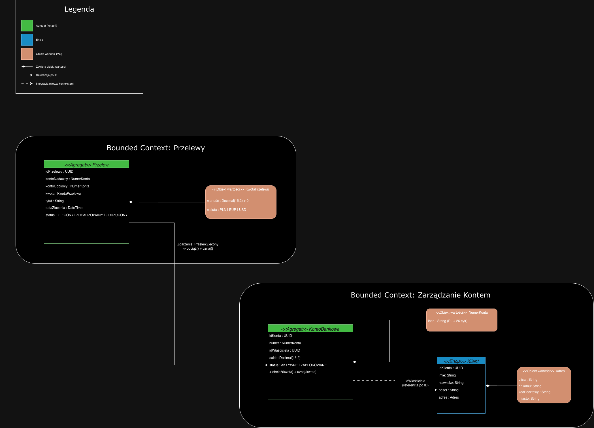

# Zadanie 1 – Domain Driven Design: przelew między kontami

## Opis zadania

W zadaniu zaprojektowałam fragment aplikacji bankowej według zasad Domain Driven Design. Wybrałam jedną funkcję: zlecenie przelewu z jednego konta na drugie. System podzieliłam na dwie części: Zarządzanie Kontem i Przelewy. Dla każdego pola określiłam, jakie dane są dozwolone, a aplikacja odrzuca błędne lub niebezpieczne dane już przy tworzeniu obiektu.

## Model

Wykres z diragramIO

## Bounded Contexts

| Kontekst | Odpowiedzialność |
|---|---|
| **Zarządzanie Kontem** | Dane klienta, konta bankowe i ich saldo, obciążanie i uznawanie rachunku |
| **Przelewy** | Przyjęcie zlecenia przelewu, walidacja, zmiana statusu, przekazanie zlecenia do kontekstu kont |

## Elementy modelu

| Element | Typ | Kontekst | Opis |
|---|---|---|---|
| `KontoBankowe` | Agregat | Zarządzanie Kontem | Rachunek z saldem. Tylko on może zmieniać saldo (`obciąż` - dotyczy nadawcy, `uznaj` - dotyczy odbiorcy) |
| `Klient` | Encja | Zarządzanie Kontem | Właściciel konta, ma własną tożsamość (`idKlienta`) |
| `Adres` | Obiekt wartości | Zarządzanie Kontem | Adres zamieszkania klienta |
| `NumerKonta` | Obiekt wartości | wspólny dla obu kontekstów | Numer IBAN konta |
| `Przelew` | Agregat | Przelewy | Zlecenie przelewu ze statusem |
| `KwotaPrzelewu` | Obiekt wartości | Przelewy | Kwota z walutą |

## Przyjęte założenia / formaty danych

Zasady ogólne:
- walidacja odbywa się **w konstruktorze** obiektu. Niepoprawne dane powodują wyjątek i obiekt nie powstaje,
- w polach tekstowych **nie są dozwolone znaki** `< > " ' ; { }` ani znaki sterujące (ochrona przed XSS i wstrzyknięciami), a białe znaki na początku i końcu są usuwane,
- identyfikatory (`UUID`) i daty generuje serwer, nie są przyjmowane od użytkownika,
- obiekty wartości są niezmienne.

| Element | Atrybut | Format / ograniczenia | Przykład |
|---|---|---|---|
| Klient | `imię`, `nazwisko` | 2–50 znaków, tylko litery (także polskie), spacja lub myślnik w środku | `Anna`, `Nowak-Kowalska` |
| Klient | `pesel` | dokładnie 11 cyfr, poprawna suma kontrolna | `90010112345` |
| Adres | `ulica` | 2–80 znaków: litery, cyfry, spacja, `.`, `-` | `ul. Długa` |
| Adres | `nrDomu` | 1–10 znaków, np. `12`, `12A`, `12/4` | `12A/4` |
| Adres | `kodPocztowy` | format `NN-NNN` | `00-950` |
| Adres | `miasto` | 2–50 znaków: litery, spacja, `-` | `Warszawa` |
| NumerKonta | `iban` | `PL` + 26 cyfr, spacje usuwane przed sprawdzeniem, poprawna suma kontrolna IBAN | `PL61109010140000071219812874` |
| KontoBankowe | `saldo` | liczba dziesiętna z 2 miejscami po przecinku, nigdy ujemna | `1500.00` |
| KontoBankowe | `status` | `AKTYWNE` lub `ZABLOKOWANE` | `AKTYWNE` |
| KwotaPrzelewu | `wartość` | większa od 0, najwyżej 100 000.00, maks. 2 miejsca po przecinku | `250.50` |
| KwotaPrzelewu | `waluta` | `PLN`, `EUR` lub `USD` | `PLN` |
| Przelew | `tytuł` | 1–140 znaków: litery, cyfry, spacja, `. , - /` | `Faktura 12/2026` |
| Przelew | `kontoNadawcy`, `kontoOdbiorcy` | poprawne `NumerKonta`, konta muszą być różne | — |
| Przelew | `status` | `ZLECONY` → `ZREALIZOWANY` albo `ZLECONY` → `ODRZUCONY`. Nie można cofnąć statusu | `ZLECONY` |

## Reguły biznesowe i integracja kontekstów

| Reguła / operacja | Opis |
|---|---|
| Saldo nie może być ujemne | `KontoBankowe.obciąż(kwota)` odrzuca operację, jeśli brakuje środków |
| Zablokowane konto | Z konta o statusie `ZABLOKOWANE` nie można wysłać przelewu |
| Własne konto | Klient może zlecić przelew tylko z konta, którego jest właścicielem (`idWłaściciela`) |
| Zlecenie przelewu | `Przelew` (status `ZLECONY`) publikuje zdarzenie `PrzelewZlecony`. Kontekst *Zarządzanie Kontem* obciąża konto nadawcy i uznaje konto odbiorcy |
| Wynik | Po udanym obciążeniu przelew przechodzi w status `ZREALIZOWANY`, w przeciwnym razie `ODRZUCONY` |
| Komunikacja kontekstów | Konteksty wymieniają tylko identyfikatory, numery kont i zdarzenia, nie współdzielą encji |